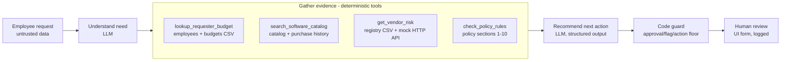
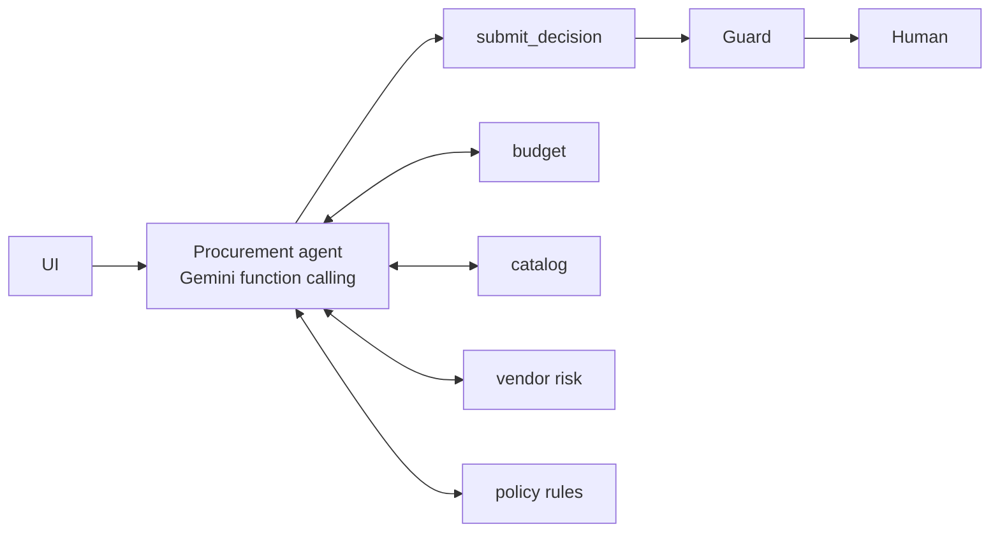
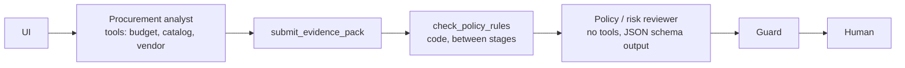

# Architecture, workflow and assumptions

## Workflow

## Architecture A - single agent

One Gemini agent sees the request (wrapped as `<untrusted_request>`), the policy text and four tools. It chooses which
tools to call and finishes by calling `submit_decision`. That is a function whose JSON schema is the decision, so
the output is always structured. Function calling runs in `ANY` mode, so the agent can only call tools or submit.
On the last turn the only tool it may call is `submit_decision`.

## Architecture B - staged analyst -> reviewer

The analyst gathers evidence and returns an evidence pack: the need, its view of existing tools, key findings and
concerns. Code then runs the policy engine. The reviewer is one JSON-schema call that reads the pack, the raw tool
results and the policy-engine output, and decides the action.

## AI / code / human split

| Concern | Owner | Where |
|---|---|---|
| What the requester needs; is there a credible gap vs. existing tools; wording of recommendation and next step | AI | `src/agents.py` |
| Budget arithmetic, approval thresholds, 365-day review freshness against the policy reference date, registry/API conflict, Security/Privacy/Legal triggers, required fields, prompt-injection scan | Code | `src/tools.py` |
| Minimum approvals, flags and action (the agent can escalate, never de-escalate) | Code guard | `src/agents.py::guard` |
| Final approval, exceptions, overrides | Human | UI review form -> `outputs/human_reviews.jsonl` |

The guard enforces these minimums:
- `required_approvals` and `risk_flags` are the union of the rules output and the agent output.
- Missing required info forces `CLARIFY`.
- A `PROCEED` that the rules say needs escalation becomes `REVIEW` or `BUDGET_EXCEPTION`.
- `human_review_required` is always `true`.
- Every evidence item is a tool finding with a file, record or policy-section reference. The LLM never writes evidence.

Every correction the guard makes is logged in the run trace and counted in the evaluation. That count is the
number of policy misses by the LLM alone.

## Tools

| Tool | Type | Source |
|---|---|---|
| `lookup_requester_budget` | deterministic | `employees.csv`, `department_budgets.csv` |
| `search_software_catalog(query?)` | deterministic (agent picks the keywords) | `software_catalog.csv`, `purchase_history.csv` |
| `get_vendor_risk` | deterministic, external HTTP | `vendors.csv` + `GET /vendor-risk/{vendor}` |
| `check_policy_rules` | deterministic policy engine | `procurement_policy.md` sections 1-10 |

## Failure handling

- **Vendor API 503/404/unreachable:** `vendor_risk_unavailable` and Security review. No favourable status is inferred.
- **Gemini error, quota or no key:** keys rotate (`GEMINI_API_KEYS=k1,k2`) on 429/5xx. If all keys fail, the
  run falls back to rules-only, and the evidence panel says so.
- **Agent never submits:** submission is forced on the last turn. If that also fails, the run falls back to rules-only.
- **Prompt injection:** request text goes inside `<untrusted_request>` tags, and the system prompt says it is data.
  A regex scan of request fields and vendor notes raises `prompt_injection_detected`. The guard means injected text
  can't remove an approval or lower the action.

## Assumptions

- The reference date is read from `procurement_policy.md` (2026-09-30), never from the system clock.
- A security review is current for 365 days from the latest review date in either source. A status disagreement
  between the registry and the API (e.g. `Approved` vs `expired`) is a conflict. `Pending` and `not_completed` are
  treated as the same thing.
- Overlap is flagged by code when a different vendor's product in the same category is available to the requester's
  department, or the product name is an exact duplicate. Same-vendor expansions (add-ons, more seats) are left to the
  agent's judgement. For example, SignFlow add-on seats are legitimate, while TaskFlow Pro for Marketing duplicates the
  company-wide TaskFlow.
- Privacy review is triggered by employee or customer PII, or by sensitive (PII or confidential) data at a vendor that
  stores data outside the region. In that second case Legal is also required, as a cross-region issue.
- Legal is required for a non-approved vendor at $10,000 or more (inclusive), for legal terms other than `Approved`,
  or for a cross-region sensitive-data issue.
- An empty `requested_integrations` list means "none". Only `null` counts as missing. `data_access_level: "unknown"`
  counts as missing.
- When the cost is missing, the threshold approvers are unknown. Procurement is listed to triage the clarification.

## Not built (on purpose)

No purchasing, budget writes or approval actions. No auth, no database (human decisions go to a JSONL log), no
retrieval over the policy (it fits in the prompt), no more than 2 agents.

## Starter-pack fixes

- `evals/run_public_evals.py` called the solution without starting the vendor-risk API. Every vendor lookup failed,
  so the cases were judged against an outage. The runner now starts the API if it isn't running
  (`mock_api/server.py`).
- `.gitignore` excluded the result files that the brief asks us to submit. Results now go to the tracked
  `evals/results/` folder.
- The provider SDK was missing from `requirements.txt`. `google-genai` is now added.
- `gemini-2.5-flash` is closed to new API users. The default model is now `gemini-3.8-flash`, set by `MODEL_NAME`.
